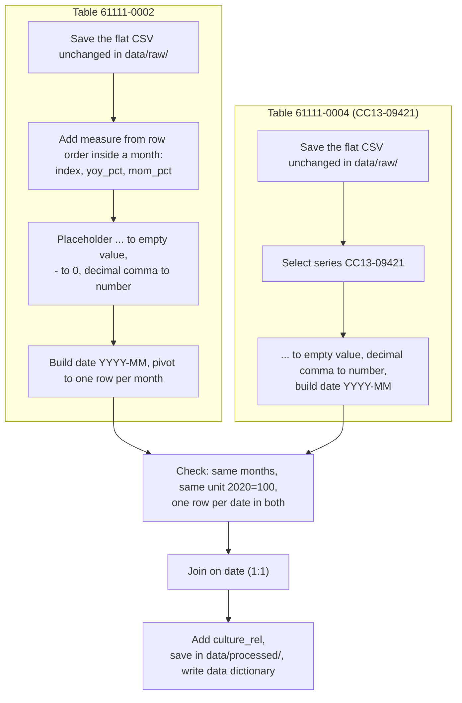

## Dataset: [Verbraucherpreisindex: Deutschland, Monate](https://genesis.destatis.de/datenbank/online/statistic/61111/table/61111-0002)
table 61111-0002

### 1. Facts

|  | Verbraucherpreisindex für Deutschland |
|---|---|
| Full title | Verbraucherpreisindex: Deutschland, Monate, table 61111-0002 |
| Publisher | Statistisches Bundesamt (Destatis), GENESIS-Online |
| Link / identifier | https://genesis.destatis.de/datenbank/online/statistic/61111/table/61111-0002 · table 61111-0002 · statistic 61111 |
| Formats | CSV (flat layout), downloaded; CSV; XLSX |
| Size | 1 file, 57,233 bytes (≈56 KB); 360 data rows + 1 header row, 18 columns (flat format: one row per month and measure; 3 measures × 120 months) |
| Coverage period | Jan 2017-Dec 2026 (120 months per measure). Observations exist from Jan 2017 to Sep 2026 (117 months). Oct-Dec 2026 contain the placeholder `...` (9 cells in total) |
| Coverage area | Germany (national, `DG`), no regional breakdown |
| Granularity | Monthly. Three measures: index (2020 = 100), change vs. the same month of the previous year (%), change vs. the previous month (%) |
| Last update | The file has no export timestamp, but the last update can be checked on the [dataset page](https://genesis.destatis.de/datenbank/online/statistic/61111/table/61111-0002). Latest value: Sep 2026 |
| Licence | Datenlizenz Deutschland – Namensnennung – Version 2.0 (dl-de/by-2-0), [stated](https://www.destatis.de/DE/Service/Impressum/copyright-genesis-online.html) by Destatis for GENESIS-Online |

### 2. Stars (5-star scheme)
★★★ Open format (CSV, no proprietary software needed).
Missing for the 4th and 5th star: URIs to identify entities in the data and links to other datasets.

### 3. Open the data

The file was opened in Microsoft Excel 365 and Notepad++. Encoding: UTF-8 with BOM, separator: semicolon. `value` column was imported as text, therefore it was additionally transformed via Transform Data -> Data Type -> Decimal Number.

Statistics per measure, over the months with a numeric value (Jan 2017–Sep 2026):

| Measure | Values | Min | Max | Mean |
|---|---|---|---|---|
| Price index (2020 = 100) | 117 | 95,1 | 126,6 | 108,59 |

**Empty cells:** the `value` column has 0 empty cells. Instead, it contains two placeholders: `...` in 9 rows (Oct–Dec 2026) and `-` in 13 rows (all in the month-on-month change, means 0 and reflect no change). The `value_q` (flag) column is empty in exactly these 22 rows.

**Odd things:**
 
- The two `%` measures cannot be told apart by any column. Year-on-year and month-on-month rows have the same `value_unit` (`%`), the same `value_variable_code` (`PREIS1`) and the same label `in`. Only the order of rows inside a month separates the measures: index, then year-on-year, then month-on-month.
  I checked this order against the index. For all 117 months, the second row matches the recomputed year-on-year change and the third matches the month-on-month change (maximum deviation 0,05, which is rounding).
  A column `measure` has to be built from this order, so the file must not be re-sorted before that step.
- The value `in` in `value_variable_label` looks strange (probably "in %").
- Rows are not sorted by time.
- 11 of 18 columns have the same value in every row (for example `statistics_code`, `time_code`, `2_variable_attribute_code`).
- Year (`time`) and month (`1_variable_attribute_code`, e.g. `MONAT02`) are in separate columns, so a date `YYYY-MM` has to be built.
- Numbers stored as text.

### 4. Data dictionary

| Column | Meaning | Type and unit | Example |
|---|---|---|---|
| `time` | Year of the observation | integer, year | `2025` |
| `1_variable_attribute_code` | Month of the observation (`MONAT01`–`MONAT12`); the label is in `1_variable_attribute_label` | text | `MONAT07` (Juli) |
| `value` | Index or rate of change, depending on the row (see `value_unit` and the row order) | decimal number (text with decimal comma), or placeholder `...` / `-` | `122,2` |
| `value_unit` | Unit of the value: index points with base year, or percent | text | `2020=100` or `%` |
| `value_q` | Quality flag of the value | text | `e` |

**Documentation by the publisher:** Destatis documents the statistic, not the columns of the CSV. The meaning of `e`, `...` and `-` is in the Zeichenerklärung (Sign Explanation) on the dataset page. There is no description of the columns and no description of how the three measures are ordered in the flat file.

### 5. License and Attribution line (TASL)

**Open according to the Open Definition?** Yes. The licence dl-de/by-2-0 allows free use, modification and sharing, including commercial use, and only requires attribution.

**What we must do when reusing it:** name the provider (Statistisches Bundesamt (Destatis)), add the licence note "dl-de/by-2-0" with a link to the licence text, refer to the dataset (with a link), and state that the data is changed ("own calculation") if it is being modified.

> Source: [Copyright for the Genesis-Online database](https://www.destatis.de/EN/Service/Legal-Notice/CopyrightGENESISOnlineDatabase.html)

**Attribution line for the README:**\
"Verbraucherpreisindex: Deutschland, Monate (Table 61111-0002)" by Statistisches Bundesamt (Destatis), Genesis-Online, https://genesis.destatis.de/datenbank/online/statistic/61111/table/61111-0002, [Data licence by-2-0](https://www.govdata.de/dl-de/by-2-0)

### 6. People
The dataset contains *no personal data*. It is a monthly national price index, aggregated over all of Germany, with no individuals, households or small groups, therefore nothing needs to be minimised for this dataset.

## Dataset Review with the FAIR principles
 
| Principle | Rating | Evidence |
|---|---|---|
| F1 | ~ | Stable URL and table code `61111-0002`, no DOI. The CSV contains only `statistics_code` = `61111`, and the table number appears only in the file name and on the website. |
| F2 | ~ | The table page has a title, unit and "Stand" date. The CSV repeats `statistics_code` and `statistics_label` in each row, but has no title line, copyright line or date. |
| F4 | ~ | Searchable in GENESIS-Online by table code. |
| A1 | ✓ |  Datasets from [GENESIS-Online](https://www.destatis.de/EN/Service/OpenData/api-webservice.html) "can be used free of charge and without registering", and all users get the same data. Tables can be both viewed in the web interface and downloaded from there |
| I1 | ✓ | CSV, UTF-8 with BOM, semicolon, decimal comma, one header row, one observation per row. |
| I2, I3 | ✗ | The month is a code (`MONAT02`) with a German label, not ISO 8601. The area is the code `DG`, not ISO 3166. Placeholders are text. No links to other data. |
| R1 | ✗ | No column dictionary. The two `%` measures are not identified in any column. |
| R1.1 | ✓ | Clear licence on the Destatis page. The CSV itself has no licence information. |
| R1.2 | ~ | Original data from the primary publisher (Statistisches Bundesamt), not a copy. The methodological notes describe who collects the data and how (price collection by the statistical offices around the middle of the month, quality checks). The flat CSV file has no timestamp or version, so the retrieval date must be recorded by the user. |
| R1.3 | ? | **To be added** |

The chosen dataset is **open**: the licence dl-de/by-2-0 allows free reuse and modification with attribution, and the data is free to download as CSV. It is also **FAIR, but with limitations**. It has a stable URL, open access and a licence, but no DOI, no version, no ISO dates, no data dictionary, and the measures are only distinguishable by row order.

3 things to improve for milestone 2:
- Publish the final table with a persistent identifier and a version.
- Use ISO 8601 dates and add a `LICENSE`/metadata file with the Destatis licence.
- Write a data dictionary for every column, and document in the script how `measure` is derived and how the retrieval date is recorded.

## What to combine the chosen dataset with
 
**Second source: table [61111-0004](https://genesis.destatis.de/datenbank/online/statistic/61111/table/61111-0004), series CC13-09421 "Besuch von Kino, Theater, Konzert, Zirkus u.Ä."**
 
Both tables belong to the same statistic (`61111`), use the same time, month and area coding, and the same base year (2020 = 100). The headline index is the parent of the CC13-09421 series: CC13-09421 is one of its components. In 0004 the nesting is CC13-09 > CC13-094 > CC13-0942 > CC13-09421. This means the two series are not independent, which matters for the analysis (see the verdict).
 
### Shared key 

Both sources contain a time dimension. The shared key will be the year and month.

| Source | Original date format | After cleaning |
|---|---|---|
| Destatis VPI, headline index (table 61111-0002) | Year in `time` (`2017`) and month as code in `1_variable_attribute_code` (`MONAT01`, label `Januar`) | 2017-01 |
| Destatis VPI, series CC13-09421 (table 61111-0004) | Year in `time` (`2017`) and month as code in `1_variable_attribute_code` (`MONAT01`, label `Januar`) | 2017-01 |

Both tables come from the same statistic (`61111`) and use the same coding of time, month and area, so no format conversion between them is needed. The Destatis month code is turned into a number (the last two digits of `MONAT01`), and the date is built as `YYYY-MM` (ISO 8601) from `time` and this number.

Table 61111-0002 has three rows per month (index, year-on-year change, month-on-month change). For the join, the index (first row of each month) is used; the two rates are kept as separate columns after the pivot.

**Derived column for the joined table (own calculation)**:\
 `culture_rel` = `culture_index` / `cpi_index` × 100: price of cultural events relative to the overall price level.

### Granularity
Both tables are monthly and national, so there is no aggregation step.
 
### Research questions
1. Do prices of cinema, theatre, concert and circus visits move differently from overall consumer prices in Germany (level `culture_rel` and year-on-year rates)?

### Licences
Both tables are published by Destatis under dl-de/by-2-0, so the combined table can be published with one attribution block naming both tables, the licence link, and a note "own calculation" for derived columns.

### Verdict
Yes, I would build the project on this pair: both tables are open (dl-de/by-2-0), come from the same statistic with identical coding of time, month and area, and join 1:1 on `YYYY-MM`. The main risks:
- **The measure column is not in the file.** It depends on row order, so the order check against the index should be part of the script.
- **Part-whole relation.** CC13-09421 is a component of the general index, so the two series are not independent and some co-movement is built in. The analysis should focus on how the culture series differs from the headline index (relative price `culture_rel`, timing of changes), and the results should be read with this limitation in mind.
- **Pandemic months.** The culture series has `()` flags in Apr–Jun 2020 and Nov 2020–Jun 2021, which may distort the comparison.
